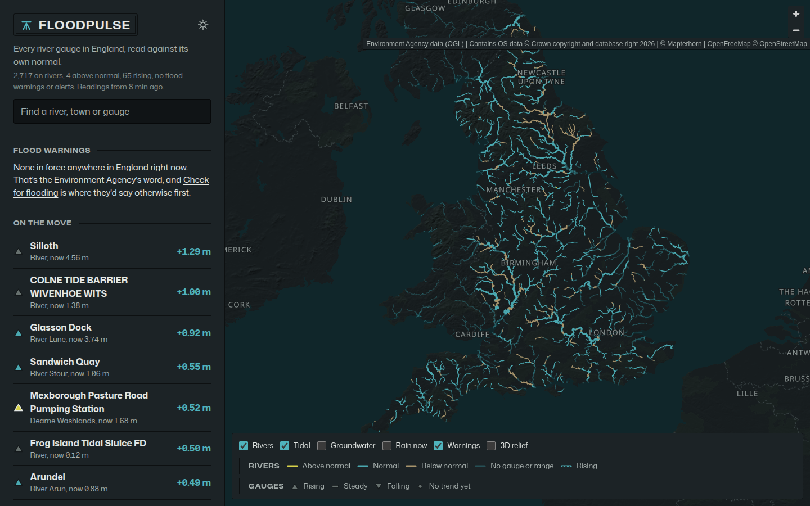

<h1 align="center">floodpulse</h1>
<p align="center">
<i>Every river gauge in England on one live map, each read against its own normal</i>
<br />
<b>🌐 <a href="https://floodpulse.peng.ly/">floodpulse.peng.ly</a></b><br />
</p>

<p align="center">

</p>

<details>
  <summary>Contents</summary>

- [About](#about)
- [Deployment](#deployment)
- [Development](#development)
- [Credits](#credits)

</details>

## About

A live map of England's rivers, coloured by the Environment Agency gauges watching them. Each stretch takes its colour from where its gauge's level sits against that gauge's own normal range, so a big river and a tiny brook compare fairly, and stretches that are rising get dashes walking downstream. Official flood warnings and alerts go on top, with the areas they cover, and you can switch on the tidal, groundwater and rain gauges too.

Pick a river and it lights up from source to sea, with every gauge along it on one chart. Pick a gauge (or search for your river or town) and you get its level on a carved scale beside its record and recent highs, the last five days of readings, and the next gauges up and down the river. It refreshes itself every 15 minutes, which is as often as the EA updates.

It's not an official service, so for anything that matters use [Check for flooding](https://check-for-flooding.service.gov.uk/).

---

## Deployment

### Option 1: Cloudflare Workers

This is how the live site runs. It needs a KV namespace for the readings and a cron to fetch them. Fork it, then:

```bash
npm install
npx wrangler kv namespace create STORE
```

Pop the id it prints into `kv_namespaces` in `wrangler.jsonc`, change `ORIGIN` and `routes` to your own domain (or delete `routes` to just get a `workers.dev` address), then:

```bash
ADAPTER=cloudflare npm run build
npx wrangler deploy scripts/worker.js
```

`scripts/worker.js` is what adds the cron, so deploy that rather than the plain build.

### Option 2: Docker

There's a multi-arch image on DockerHub ([`notaflightrisk/floodpulse`](https://hub.docker.com/r/notaflightrisk/floodpulse)) and GHCR ([`ghcr.io/notaflightrisk/floodpulse`](https://github.com/NotAFlightRisk/floodpulse/pkgs/container/floodpulse)). With Docker installed, just run:

```shell
docker run -p 3000:3000 notaflightrisk/floodpulse
```

It keeps the readings in memory and fetches them itself every 15 minutes, so trends start showing up three hours after it starts.

### Option 3: From a release

Grab `site.zip` from the [latest release](https://github.com/NotAFlightRisk/floodpulse/releases/latest), unzip it and run `node build`. There's nothing to install. It listens on port 3000, or whatever you set `PORT` to.

### Option 4: Build from source

Follow the [Development](#development) steps, then `npm run build` and `node build`.

---

## Development

You'll need [Node](https://nodejs.org/) 22.12 or newer. It's a [SvelteKit](https://svelte.dev/docs/kit) app, and nothing needs an API key, not even the map.

```bash
git clone git@github.com:NotAFlightRisk/floodpulse.git
cd floodpulse
npm install
npm run dev
```

The dev server is then on [localhost:5173](http://localhost:5173), and the first page load waits while it fetches every station from the EA. The other scripts you'll want are `npm run check` (types), `npm test` and `npm run format`.

The river network is built ahead of time from [OS Open Rivers](https://osdatahub.os.uk/downloads/open/OpenRivers), and the tiles and river list it makes are checked in, so you only need this when the OS puts out a new one. Grab the GeoPackage, unzip it, and run `npm run rivers -- path/to/oprvrs_gb.gpkg`.

Browsers only ever talk to us, never to the EA directly. The server grabs the latest readings every 15 minutes, keeps the last four hours of each gauge to work out which way it's going, and caches each gauge's five-day history for five minutes.

---

## Credits

River levels, rainfall and flood warnings are from the [Environment Agency's flood monitoring API](https://environment.data.gov.uk/flood-monitoring/doc/reference), under the [Open Government Licence](https://www.nationalarchives.gov.uk/doc/open-government-licence/version/3/). The rivers are [OS Open Rivers](https://www.ordnancesurvey.co.uk/products/os-open-rivers) (contains OS data © Crown copyright and database right 2026). The rest of the map is [OpenStreetMap](https://www.openstreetmap.org/copyright) data served by [OpenFreeMap](https://openfreemap.org/), with hills from [Mapterhorn](https://mapterhorn.com/), drawn by [MapLibre](https://maplibre.org/). Thanks to all of them for keeping it free.

---

<!-- License + Copyright -->
<p  align="center">
  <a href="https://github.com/NotAFlightRisk"></a><br>
  <sup>
    <i>Licensed under <a href="../LICENSE">MIT</a>, © <a href="https://peng.ly">NotAFlightRisk</a> 2026</i>
  </sup>
</p>

<!--
oooh, hello there! hope you're having a nice day :)
   |\__      |\___
 (:> __)X  (:o ___(
   |/        |/
-->
